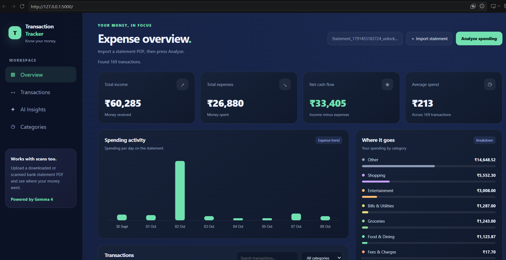

# Transaction Tracker

Upload a bank statement PDF (a downloaded one or a scan) and get your total spending,
a category breakdown, your biggest spends and a short written summary.

**Model:** `gemma-4-26b-a4b-it` (Gemma 4 through the Gemini API, using the `google-genai` package)



## How it works

1. You pick a PDF and click **Analyze statement**.
2. The server reads the text from the PDF. If there is almost no text (a scan), it turns the pages into one image instead.
3. One Gemma call (`ask` or `ask_with_image` from `gemma_client.py`) returns the transactions as JSON.
4. Plain Python adds up the totals and categories. No database, no login.

## How to run

1. Install Python 3.10 or newer.
2. Install the packages:
   ```
   pip install -r requirements.txt
   ```
3. Copy `.env.example` to `.env` and put your key in it:
   ```
   GEMINI_API_KEY=your-key-here
   ```
   `.env` is in `.gitignore`, so it is never committed.
4. Start the app:
   ```
   python app.py
   ```
5. Open http://localhost:5000, choose a PDF and click **Analyze statement**.

## Files

- `gemma_client.py` – the Gemma helper (unchanged)
- `app.py` – the Flask server
- `static/index.html` – the single page
- `LICENSE` – license for this project
